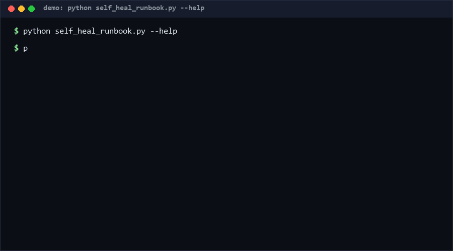

# self-heal-runbook

A declarative format for self-healing runbooks — fault signature → diagnostics → remediation → verification, with rollback as an optional tail — plus a strict validator and a dry-run planner that proves execution order without running anything. Pure standard library, zero side effects.

<p align="center"></p>

## Problem

Self-healing scripts rot into "bash mythology": a cron job someone wrote in 2021, an ordering assumption nobody documented, a fix with no verification step that silently stops fixing. When the pager fires you want a *validated artifact* that says exactly what fires it, what gets checked, what gets fixed, how the fix is verified, and how to undo it — and you want a machine to confirm the artifact is well-formed before an incident, not during one.

## How it works

A runbook is a JSON document with four step phases and triggers:

```json
{"name": "disk-full-heal", "runbook_version": "1.0",
 "triggers": [{"type": "log_signature", "pattern": "No space left on device"}],
 "diagnostics": [{"id": "d1", "command": "df -h"}],
 "remediation": [{"id": "r1", "command": "rm -rf /tmp/cache/*", "requires": ["d1"], "max_attempts": 2}],
 "verification": [{"id": "v1", "command": "df -h", "verifies": ["r1"]}]}
```

The validator enforces: unique step ids; non-empty diagnostics/remediation/verification; trigger schema (`log_signature|metric|manual|alert` + pattern); `requires` referencing existing ids; an acyclic `requires` DAG; and the **closed-loop rule** — every remediation step must be covered by at least one verification step's `verifies` list. `plan` emits a deterministic topological order (diagnostics before remediation before verification, ties by declaration order).

## Quickstart

```bash
# Validate a runbook (~0.05s [estimated, repro: time python self_heal_runbook.py validate rb.json])
python self_heal_runbook.py validate runbook.json

# Print the dry-run execution plan — nothing is executed
python self_heal_runbook.py plan runbook.json

# Full self-test, 50 checks (~0.3s [estimated, repro: time python self_test.py])
python self_test.py
```

## How this differs (why-not-X)

| Alternative | Stars* | How this repo differs |
|---|---|---|
| [NS145/WardNode](https://github.com/NS145/WardNode) | 0 | A self-healing *engine* that automates remediation at runtime; this is the format + validator + dry-run planner layer — it decides nothing at 3am, it guarantees the document is executable-looking before 3am. |
| [NS145/RunForge](https://github.com/NS145/RunForge) | 0 | Same engine family (declarative remediation automation); this adds an explicit closed-loop rule (remediation must be verified) and a zero-side-effect plan command. |
| [raman01211/k8s-anomaly-detector](https://github.com/raman01211/k8s-anomaly-detector) | 0 | Detects anomalies with ML and suggests root causes upstream; this consumes the detection output as a trigger signature and validates the human response plan. |

\* Stars from the R13 precheck snapshot, as of 2026-10-11.

## Minimal Fallback

Without this tool: enforce the same shape by review with a checklist — (1) trigger has a literal pattern, (2) every step has an id and command, (3) remediation has a verification sibling, (4) no step depends on a later-declared step. Store runbooks as JSON in git and let `python -c "import json;json.load(open('rb.json'))"` at least catch syntax. You lose DAG/cycle/closed-loop checks — that is exactly what the validator adds.

## Design Trade-offs

- **Declarative JSON over a DSL** — diffable, reviewable, zero-parser; you lose looping/conditionals (deliberately — logic belongs in the commands, not the plan).
- **Plan-only, never executes** — this tool cannot fix anything, which is also why it cannot break anything; wiring commands to an executor is a separate, riskier layer.
- **Closed-loop as a hard rule** — some legit one-way actions (rotate a log) cannot be "verified"; authors work around with an echo-verification, a small dishonesty price for never shipping unverifiable fixes.
- **Phases are ordered by construction** — less flexible than a general workflow engine, far easier to reason about under incident stress.

## Limits & Second-order Effects

- Validation proves structure, not correctness: `rm -rf` passes every check. Second-order: teams may over-trust "validated" runbooks — require human review of command content separately.
- Triggers are declarative strings; nothing here watches logs or metrics.
- No secrets handling: commands are plaintext; injecting credentials is the executor's problem (and a leak risk — keep secrets out of runbook files).
- Rollback steps are validated but not linked to remediation steps; rollback completeness is a human concern.

## FAQ

**Does `plan` run the commands?** No. It only computes and prints the order; the module contains no execution code.

**Can one verification cover two remediation steps?** Yes — list both ids in its `verifies`.

**Why reject extra whitespace in step ids?** Ids are keys for `requires`/`verifies`; `" d1"` vs `"d1"` bugs are silent and awful.

**When NOT to use this?** Do not use it as an autonomous remediation system — there is no executor here by design; do not use it for flows needing conditional branching or human-approval gates mid-plan; skip it if your team already runs a workflow engine (Temporal, Airflow) — model runbooks there instead of maintaining a parallel format.

## [Core Assumptions]

1. Incident-time reliability comes from pre-validated, pre-ordered artifacts, not from flexible runtime logic.
2. Every remediation deserves a verification step; unverifiable fixes should not be automated.
3. JSON with human-chosen unique ids is sufficient machinery for reviewable runbooks.
4. Commands are opaque strings to this tool; their safety is the author's and reviewer's responsibility.

---

*Confidence: high — the validator and planner are small, deterministic, and covered by a 50-check self-test; star counts from the R13 precheck snapshot. Content as of 2026-10-11.*

---

Part of the [zhengming-toolbox](https://github.com/chenhz01/zhengming-toolbox) — 55 purpose-built AI-engineering tools across neglected niches.

Related tools: [deploy-checklist-code](https://github.com/chenhz01/deploy-checklist-code) · [quota-aware-scheduler](https://github.com/chenhz01/quota-aware-scheduler) · [meeting-notes-to-tasks](https://github.com/chenhz01/meeting-notes-to-tasks)
